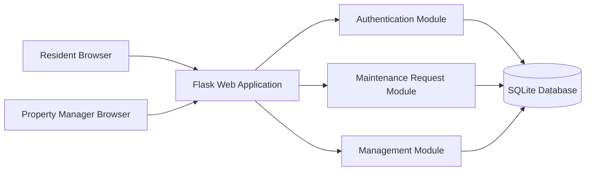

# FixIt — Project Record (Labs 01–03)

## Lab 01 — Team and product goal

### Problem
Apartment maintenance requests are often reported through calls, messages, or email. Requests can be forgotten, residents may not know their current status, and property managers may lack one clear place to organize work.

### Product goal
FixIt will provide apartment residents with a simple way to report maintenance problems and track their resolution, while allowing property management to review, prioritize, and process those requests.

### Target users
**Resident**
- Report a maintenance issue
- View submitted requests
- Check current status

**Property Manager**
- View incoming requests
- Review details
- Update status and priority
- Organize unresolved work

### Candidate user journeys

#### Journey 1 — Report a problem
1. Resident signs in.
2. Resident opens Create Request.
3. Resident enters title, description, and category.
4. Resident submits the request.
5. System creates it with status **New**.

#### Journey 2 — Process a request
1. Property manager signs in.
2. Manager opens the request list.
3. Manager opens a request.
4. Manager updates the request status.
5. The new status becomes visible to the resident.

#### Journey 3 — Check progress
1. Resident signs in.
2. Resident opens My Requests.
3. Resident selects a request.
4. System shows the request details and current status.

### Assumptions
- Users have a modern web browser and internet access.
- Residents enter maintenance problems manually.
- The first version targets one small residential property.
- Property management checks new requests regularly.
- The semester data set is small.

### Glossary
- **Resident:** apartment occupant who reports and tracks a maintenance problem.
- **Property Manager:** authorized user who reviews and manages maintenance requests.
- **Maintenance Request:** one reported maintenance problem stored by FixIt.
- **Category:** type of maintenance problem, such as Plumbing or Electrical.
- **Priority:** operational urgency assigned to a request.
- **Status:** current workflow state of a request.
- **Sprint:** one implementation iteration with a goal, review, and retrospective.
- **Definition of Done:** agreed conditions that must be satisfied before work is considered complete.
- **CI:** Continuous Integration; automated checks that run when code changes are pushed or proposed.

### Risks
- **Product:** users may prefer phone/messages. Mitigation: keep reporting fast and simple.
- **Technical:** role permissions may be implemented incorrectly. Mitigation: define and test authorization early.
- **Data:** one resident could access another resident's request. Mitigation: enforce ownership/role checks.
- **Scope:** too many optional features may be added. Mitigation: protect the MVP and keep an explicit out-of-scope list.
- **Process:** this project is currently individual despite the course's normal team model. Mitigation: keep work traceable and document the deviation honestly.

### Out of scope
- Payments and rent management
- Native mobile application
- AI fault diagnosis
- IoT/smart-home integration
- Real-time chat
- External maintenance-company integration
- Automatic technician scheduling
- Complex enterprise analytics

### Working agreement (individual adaptation)
- All planned work is recorded as GitHub issues.
- Important decisions are recorded in documentation, issues, or PRs.
- Work is developed on feature branches where appropriate.
- A task is not marked Done until acceptance criteria and tests are satisfied.
- Blockers are recorded instead of being hidden.
- Peer review is not claimed unless a real second reviewer participates.

---

## Lab 02 — Backlog and requirements

### Prioritized backlog
1. **US-01 Authentication:** As a resident, I want to sign in so that I can access my requests securely.
2. **US-02 Create request:** As a resident, I want to create a maintenance request so that I can report a problem.
3. **US-03 My requests:** As a resident, I want to view my requests so that I can track reported problems.
4. **US-04 Manager request list:** As a property manager, I want to view submitted requests so that I can manage maintenance work.
5. **US-05 Update status:** As a property manager, I want to update request status so that progress is visible.
6. **US-06 Priority:** As a property manager, I want to set priority so urgent work is handled first.
7. **US-07 Request details:** As a user, I want to view request details.
8. **US-08 Edit request:** As a resident, I want to correct a newly created request.
9. **US-09 Cancel request:** As a resident, I want to cancel an unresolved request.
10. **US-10 Filter requests:** As a property manager, I want to filter requests.

### Prioritization rationale
Items are ordered by user value, dependency, risk, and demonstrability. The first vertical slice is: resident identifies themselves → submits a request → manager can see it.

### Acceptance criteria

#### US-02 — Create maintenance request
- Signed-in resident can open the request form.
- Title, description, and category are required.
- A valid submission creates one request.
- New requests start with status **New**.
- Created request appears in the resident's list.
- Missing required fields are rejected.

Example:
**Given** a signed-in resident  
**When** they submit a plumbing problem with all required fields  
**Then** the system creates a request with status **New**.

#### US-03 — View my requests
- Resident can see their own requests.
- Each item shows at least title, category, status, and creation date.
- Resident cannot see another resident's private requests.
- Selecting a request opens its details.

#### US-04 — Manager views requests
- Property manager can access the submitted-request list.
- Newly created requests appear in the list.
- Manager can open request details.
- Resident cannot access manager-only pages.

#### US-05 — Update request status
Allowed statuses: **New, Assigned, In Progress, Resolved**.
- Only authorized management role can change status.
- Valid status is stored and visible to the resident.
- Invalid status values are rejected.

### Quality constraints
**Security**
- Passwords must not be stored as plain text.
- Private functions require authentication.
- Residents cannot modify another resident's requests.
- Secrets are not committed to Git.

**Usability**
- Basic request submission should require only essential information.
- Required fields and validation errors must be clear.

**Performance**
- For the expected semester-scale data set, normal pages should respond within about two seconds under normal local/test conditions.

**Data integrity**
Every request must have a unique ID, owner, title, description, category, valid status, and creation timestamp.

**Maintainability**
Business logic should be separated into understandable modules and important behavior should have automated tests.

### Measurable quality scenarios

1. **Performance scenario**  
   Given the semester-scale test data set, when a user opens a normal application page, the server response should complete within **2 seconds** under normal local/test conditions.

2. **Authorization scenario**  
   Given a resident is signed in, when they attempt to access or modify a maintenance request owned by another resident, the system must deny the operation in **100% of automated authorization tests**.

3. **Data-validity scenario**  
   Given a maintenance request submission is missing any required field (title, description, or category), the system must reject the submission in **100% of automated validation tests**.

### Oversized story split
The large story “As a property manager, I want to manage maintenance requests” is split into:
- View requests
- Open request details
- Update status
- Set priority
- Assign request
- Filter requests

---

## Lab 03 — Sprint 0 and workflow

### Method choice
**Scrum with selected XP practices**.

Scrum fits because the course requires Sprint 0 and three iterations, the product can be delivered in small vertical slices, and feedback can change priorities. XP-inspired automated testing, CI, small changes, and review practices improve engineering quality.

### Workflow
`Backlog → Ready → In Progress → Review → Done`

Blocked work is documented on the issue instead of remaining invisible.

### Definition of Done
A task is Done only when:
- Acceptance criteria are met
- Relevant automated tests pass
- Existing tests pass
- Code is traceable to the issue
- Documentation is updated if needed
- CI passes
- Change is merged to main
- No known critical defect remains

### Branch rule
Use `feature/<issue-number>-<short-description>` for meaningful feature work.

### Pull request rule
PRs should reference the issue, summarize the change, explain testing, and pass CI. A second-person approval is only recorded if a real reviewer participates. For the current individual workflow, a documented self-review checklist is used instead.

### Sprint 0 target
- Repository and README
- Project record
- Backlog as issues
- Minimal running Flask skeleton
- At least one automated test
- GitHub Actions CI
- One issue → branch → commits → PR trace
- Sprint 1 goal

### Initial architecture
FixIt uses a small modular monolith. Microservices are intentionally not used because the problem does not justify independent deployment or scaling.

Main logical areas:
- **Authentication:** login, logout, and role checks.
- **Maintenance Requests:** create, view, and later edit/cancel resident requests.
- **Management:** manager-only status, priority, and workflow actions.
- **Data layer:** persistent storage and integrity rules.

### Initial domain model
**User**
- id
- name
- email
- password_hash
- role

**MaintenanceRequest**
- id
- title
- description
- category
- priority
- status
- created_at
- updated_at
- resident_id

Relationship: one resident can own many maintenance requests.

### Sprint 0 review
Sprint 0 achieved the main setup goal:
- repository and README created,
- project record and backlog established,
- workflow and Definition of Done documented,
- minimal Flask application skeleton created,
- smoke tests added,
- GitHub Actions CI configured,
- issue → branch → pull request → merge trace demonstrated.

During the first CI runs, pytest failed because the application package was not on the Python import path in the GitHub Actions environment. The failure was kept visible instead of being hidden, recorded as issue #10, corrected through PR #11, and verified by a successful CI run.

The main limitation is that the project is currently being completed individually, while the course normally expects a team and a peer-reviewed pull request. No peer review is claimed.

### Sprint 0 retrospective
**What went well**
- Work was traceable through issues, branches, pull requests, commits, and CI.
- The first CI failure exposed a real setup problem early.
- The fix was handled as a separate issue and pull request.

**What could be improved**
- CI should be validated before considering a setup task complete.
- The project board and evidence links should be updated immediately when work changes state.

**Action for Sprint 1**
Before merging each Sprint 1 feature, verify that its acceptance criteria are represented by automated tests where practical and confirm CI is green before marking the issue Done.

### Sprint 1 goal
Deliver the first usable end-to-end maintenance reporting flow: a resident can submit a maintenance request and a property manager can see it.
